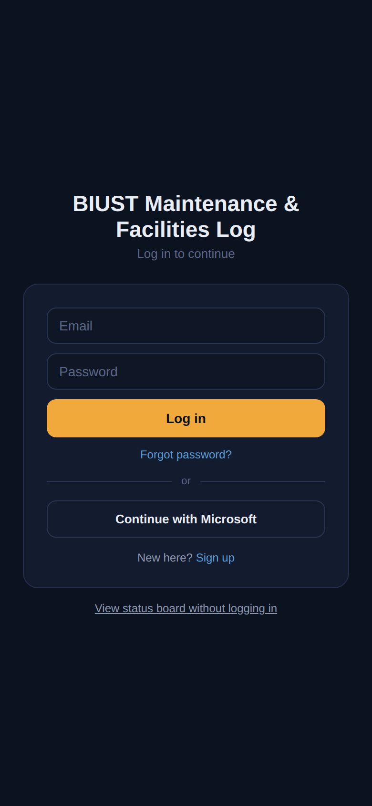
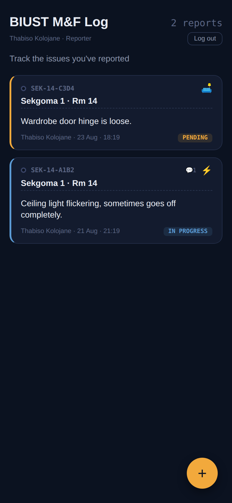
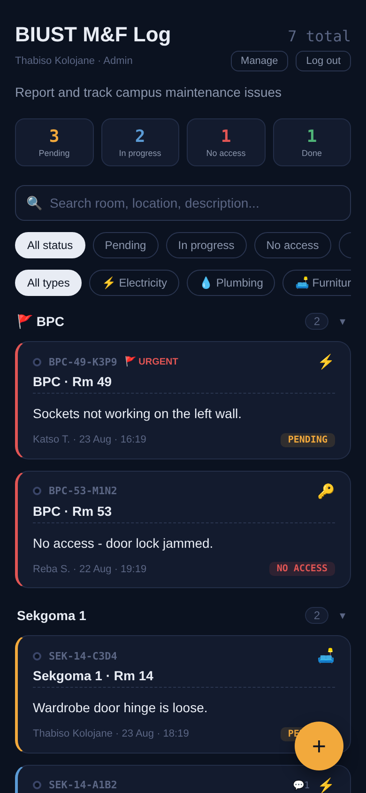
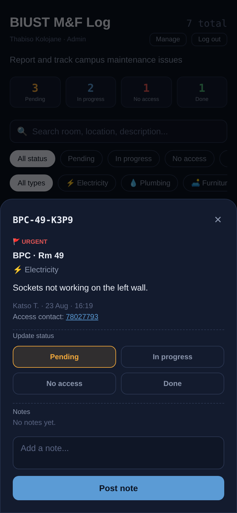
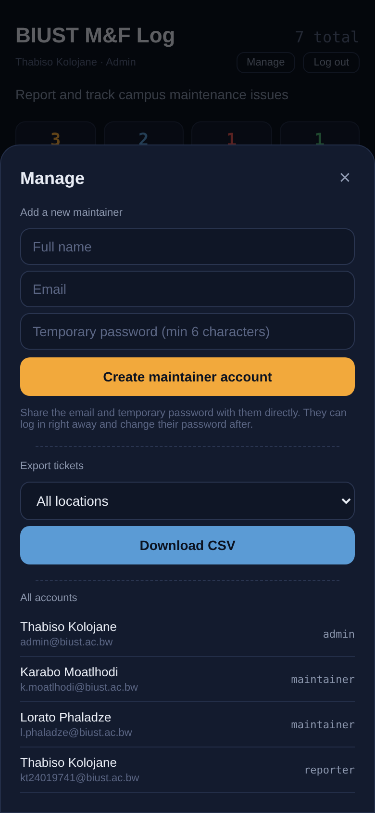
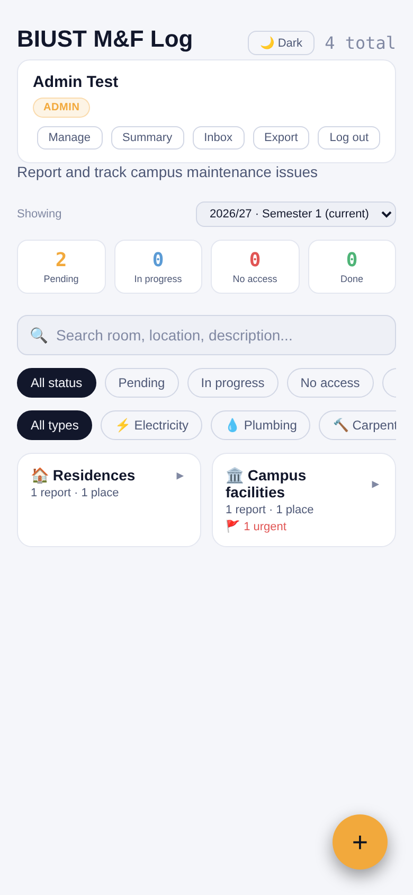
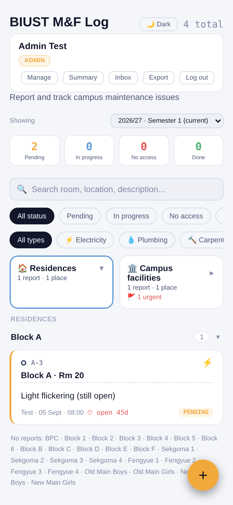
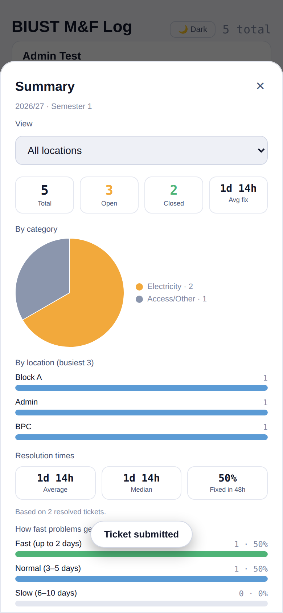
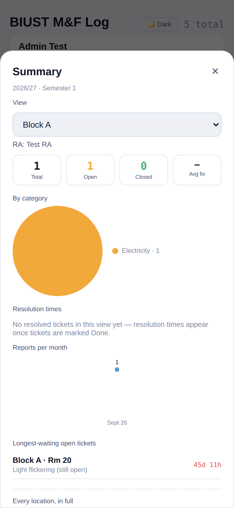
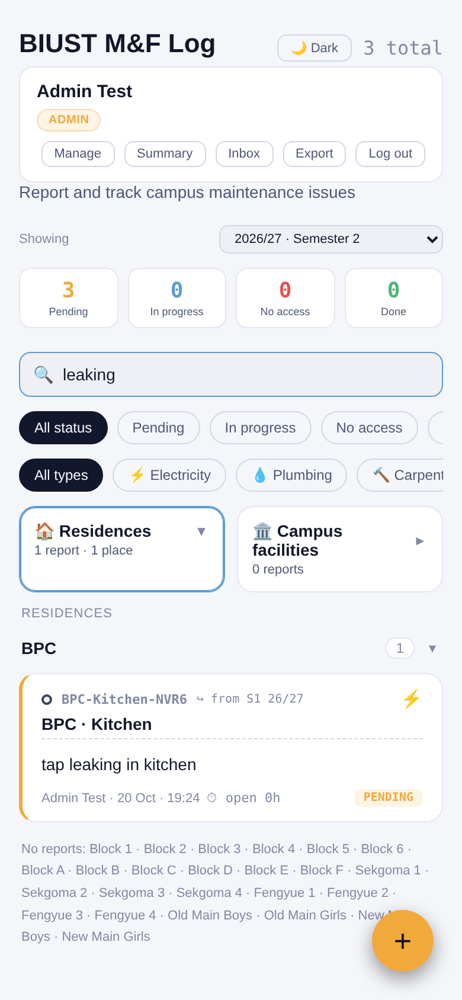

# BIUST Maintenance & Facilities Log

A shared, real-time tool for reporting and tracking maintenance issues across BIUST accommodation blocks and campus facilities — built to replace the old WhatsApp "MAINTENANCE&FACILITIES" group, where reports piled up in one long, unsearchable thread with no record of what got fixed.

It's a React app (Vite build, auto-deployed by GitHub Actions) backed by Firebase, installable to a phone's home screen like a native app.

**Live app:** https://yunghit.github.io/Biust-Maintenance-Log/

---

## Screenshots

| Login | Reporter view |
|---|---|
|  |  |

| Maintainer/admin board | Ticket detail |
|---|---|
|  |  |

| Admin — manage |
|---|
|  |

*These are illustrative screenshots with sample data, not real student reports — taken from an earlier build. They're now a little out of date (no dark/light toggle, old category list, no Inbox button) — the layout and interaction patterns shown are still accurate, just not every current feature. Ask if you'd like a fresh set.*

**Current dashboard and summary** (sample data):








---

## What it does

- **Anyone can report without an account** — a student submits an issue (or pastes/uploads a whole batch at once) with no login required, so casual one-off reporters never end up cluttering the accounts list. It lands in a review queue rather than going straight onto the board.
- **RAs review before anything becomes official** — the RA for that block sees submissions waiting for them, can edit any field, then accepts (which creates the real ticket, owned by them) or declines. Admin can do this for any block.
- **Bulk import** — paste a block of text with one issue per line ("F27 lights not working 071..."), or upload a CSV/Excel file, and it's parsed into an editable list before anything is submitted. Built for exactly the "100 issues at once" scenario the old WhatsApp group produced.
- **Reporters/RAs** log in, submit a ticket directly (location, room, category, description, optional photo, optional urgent flag), and track only their own reports. For a residential block, only that block's assigned RA(s) can report directly — campus facilities stay open to any reporter.
- **Maintainers** see tickets grouped by location, filter and search, and update status through a deliberate confirm step (not an accidental tap). A maintainer can be scoped to one category — an electrician set to "Electricity" only ever sees electrical tickets.
- **Supervisors** see the whole board, unfiltered, plus a Summary panel with a per-location breakdown table and Excel export — but can't change any ticket's status.
- **Admin** does everything above combined, plus creates maintainer/supervisor accounts, sets a maintainer's specialty, and sets which blocks a reporter is RA for.
- **Anyone**, logged in or not, can check a public read-only status board — useful for a student who reported something to check it's being handled, without needing an account.
- **Dark and light mode** — a toggle on the login screen and in the app header, remembers your choice.
- Search finds what you mean, not just exact phrases — "room 20" finds Block F Rm 20 *and* Block D Rm 20; "block f room 20" narrows to just that one.
- Tickets auto-archive out of the main view 7 days after being marked Done, so the active list stays short.
- **Semesters** — the board is scoped to a semester (selector on the board). Open tickets from an earlier semester carry over into the next one automatically and are tagged "↪ from S1 26/27"; past semesters stay viewable.
- **Resolution-time analytics** — average and median time to fix, percent fixed within 48h, averages by category and location, and the longest-waiting open tickets, all in the Summary panel (admin + supervisor).
- **A dashboard that opens as two tiles** — *Residences* and *Campus facilities*. Tap one to see its places with report counts (urgent ones flagged); tap a place to see its reports. Searching opens whatever matches automatically; the status tiles (Pending, In progress, …) are tappable filters.
- **Built to replace the SharePoint tracker, feature for feature** — room autocomplete from the tracker's own per-block lists (and blank/common-area rooms), one-tap common-issue wording, live "open 24d" ageing on every open ticket, speed bands, monthly trends, a per-location view with that location's RA, and an RA-coverage panel for admins. See `docs/TRACKER-PARITY.md`.
- **Import the old tracker** with a dry-run-first script (`tools/import-legacy/`) that keeps the original dates, statuses and `C-###` ids.
- A lightweight notes thread lets a maintainer leave feedback ("bulbs out of stock, ordered more") that the original reporter can see — and every status change logs itself into the same thread automatically, so there's always a record of who did what and when.
- Brief confirmation toasts after actions ("Ticket submitted," "Status updated") — no more wondering if something actually saved.
- Installable as a PWA — add it to a phone's home screen and it opens full-screen, no browser bar.

## Categories tracked

Electricity · Plumbing · Carpentry (furniture repairs) · Access/Other · Transport · WiFi · Inventory

## Roles

| Role | Can do |
|---|---|
| **Public** (no login) | View a status board (location, room, category, status, description) — no personal details, no editing |
| **Student** (no login) | Submit a single issue, or bulk-import many at once by pasting text or uploading a CSV — everything goes to a review queue, nothing appears on the board until an RA or admin accepts it |
| **Reporter/RA** (default on sign-up) | Submit tickets for any campus facility; for a residential block, only if set up as that block's RA. Review, edit, accept, or decline student submissions for their own block(s). View/delete their own tickets while still Pending, add notes to their own |
| **Maintainer** (admin-created, with a specialty) | View and update the status of tickets in their specialty category only (or all, if set to "All categories"), add notes |
| **Supervisor** (admin-created) | View every ticket across all categories, read-only — no status changes. Gets the Summary panel and Excel export |
| **Admin** (one-time manual bootstrap, then self-sustaining) | Everything above combined, plus create maintainer/supervisor accounts, set specialties, set RA block assignments, and accept/decline student submissions for *any* block |

Roles are enforced by Firestore security rules, not just hidden in the UI — a reporter genuinely cannot read someone else's ticket, an electrician-specialty maintainer genuinely cannot read a plumbing ticket, and a reporter who isn't an RA genuinely cannot create a ticket for someone else's block, even by calling Firestore directly.

## Locations tracked

BPC · Blocks 1–6 · Blocks A–F · Sekgoma 1–4 · Fengyue 1–4 · Old/New Main Boys/Girls · Student Center · Admin · Engineering Block · Science Block · Primary · Refectory

## Tech stack

- [React](https://react.dev) + [Vite](https://vite.dev) — component-based, built automatically by GitHub Actions on every push
- [Firebase Authentication](https://firebase.google.com/docs/auth) — email/password (Microsoft sign-in was built and then removed for now — see the roadmap in DOCUMENTATION.md)
- [Cloud Firestore](https://firebase.google.com/docs/firestore) — real-time database
- Hosted free on GitHub Pages, deployed via GitHub Actions (no manual build/upload step)
- Installable PWA (manifest + service worker)
- [SheetJS](https://sheetjs.com) for Excel export

## Project structure

```
src/
  main.jsx, App.jsx           entry point and top-level layout
  firebase.js                 Firebase app/db/auth initialization
  firebaseConfig.js           <- your Firebase project's keys go here (edit this, nothing else)
  contexts/AuthContext.jsx    auth state, role, specialty, RA blocks
  hooks/useTickets.js         role-aware Firestore subscription
  utils/                      constants, formatting helpers, Excel export
  components/                 one file per screen/piece (board, ticket detail, admin panel, etc.)
public/
  manifest.json, sw.js, icon-192.png, icon-512.png   PWA assets
.github/workflows/deploy.yml  builds and deploys automatically on every push to main
vite.config.js                build config — base path must match your repo name
```

You never run a build command yourself — push to `main` and GitHub Actions builds and deploys it. See [DOCUMENTATION.md](./DOCUMENTATION.md#deployment-github-actions) for how that pipeline works.

## Quickstart

1. Create a Firebase project (free Spark plan) and turn on Firestore + Email/Password sign-in.
2. Paste your Firebase config into `src/firebaseConfig.js`.
3. Publish the security rules from [DOCUMENTATION.md](./DOCUMENTATION.md#security-rules).
4. Push the whole project to a GitHub repo, then in Settings → Pages set **Source** to **GitHub Actions** (not "Deploy from a branch"). Push to `main` and check the Actions tab — it builds and deploys automatically.
5. Sign up with your own account, then manually set your own role to `admin` in the Firestore console (one-time only — see DOCUMENTATION.md).
6. From then on, use the in-app **Manage** panel to create maintainer/supervisor accounts and assign RAs to blocks.

Full step-by-step instructions, the complete data model, security rules, troubleshooting, and the roadmap are all in **[DOCUMENTATION.md](./DOCUMENTATION.md)**.
